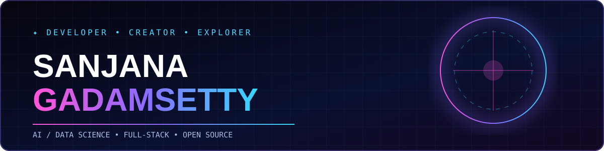

 

**AI & Data Science** &nbsp;✦&nbsp; **Full-Stack Development** &nbsp;✦&nbsp; **Open Source** &nbsp;✦&nbsp; **Creative Engineering**

---

## 💗 ABOUT ME

I’m **Sanjana Gadamsetty**, an AI & Data Science student who loves building useful products, solving coding challenges, contributing to open source, and exploring the intersection of technology and creativity.

> **Build boldly. Learn relentlessly. Create differently.**

| ⚡ BUILDING | 🧠 LEARNING | 🌐 CONTRIBUTING |
| :---: | :---: | :---: |
| Full-stack products | DSA · AI agents · Cloud | Open-source projects |

## 💜 FEATURE DASHBOARD

All enabled modules appear directly below. No expand/collapse controls.

<!-- NEON:FEATURES:START -->
<!-- Generated. Edit config/features.json, not this section. -->

### ✦ CONTRIBUTION ANIMATIONS

#### 💠 Contribution Snake

[🐍 View contribution snake workflow and output](https://github.com/SanjanaGadamsetty/actions/workflows/snake.yml)

---

#### 💠 Contribution Activity Graph

---

### ✦ GITHUB STATISTICS

#### 💠 Github Stats Cards

---

#### 💠 Most Used Languages

---

### ✦ OPEN SOURCE

#### 💠 Pull Request Tracker

---

#### 💠 Featured Repository Rotation

---

### ✦ FUTURISTIC VISUALS

#### 💠 Animated Typing Header

---
<!-- NEON:FEATURES:END -->

### 💙 TECH STACK

---

**DESIGNED TO BUILD WHAT'S NEXT** &nbsp; 💗 💙 💜

40 individually configurable README modules · Powered by GitHub Actions

