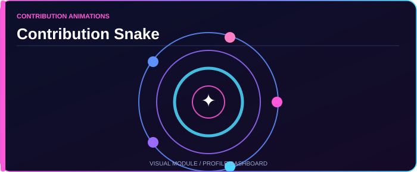
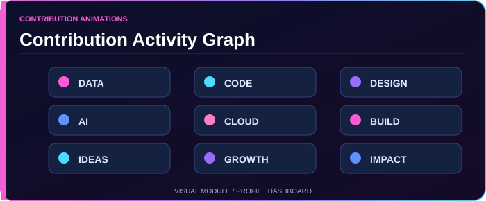
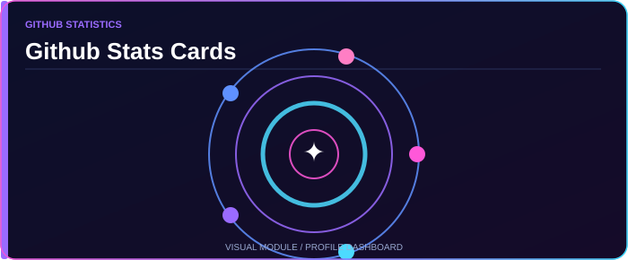
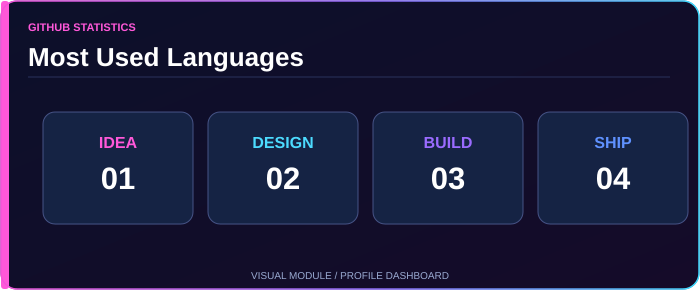
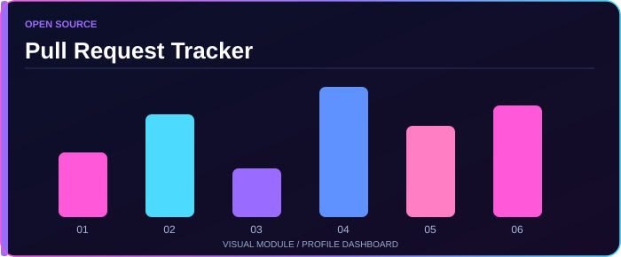
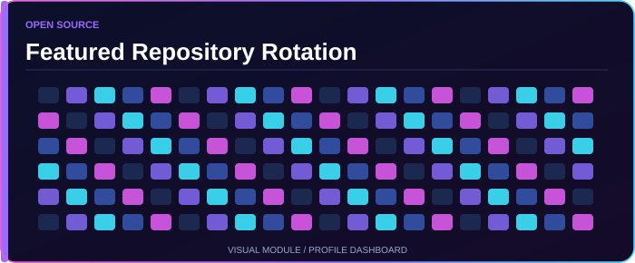
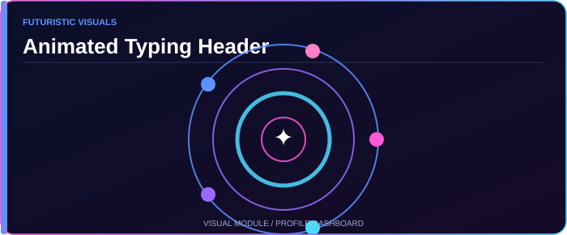

 

**AI & Data Science** &nbsp;✦&nbsp; **Full-Stack Development** &nbsp;✦&nbsp; **Open Source** &nbsp;✦&nbsp; **Creative Engineering**

---

## 💗 ABOUT ME

I’m **Sanjana Gadamsetty**, an AI & Data Science student who loves building useful products, solving coding challenges, contributing to open source, and exploring the intersection of technology and creativity.

> **Build boldly. Learn relentlessly. Create differently.**

| ⚡ BUILDING | 🧠 LEARNING | 🌐 CONTRIBUTING |
| :---: | :---: | :---: |
| Full-stack products | DSA · AI agents · Cloud | Open-source projects |

## 💜 FEATURE DASHBOARD

All enabled modules appear directly below. No expand/collapse controls.

<!-- NEON:FEATURES:START -->
<!-- AUTO-GENERATED VISUAL MODULES: edit config/features.json -->

## Contribution Animations

 

[🐍 View contribution snake animation workflow](https://github.com/SanjanaGadamsetty/actions/workflows/snake.yml)
 

 

 

---

## Github Statistics

 

 

 

 

---

## Open Source

 

 

 

 

---

## Futuristic Visuals

 

 

---
<!-- NEON:FEATURES:END -->

### 💙 TECH STACK

---

**DESIGNED TO BUILD WHAT'S NEXT** &nbsp; 💗 💙 💜

40 individually configurable README modules · Powered by GitHub Actions

