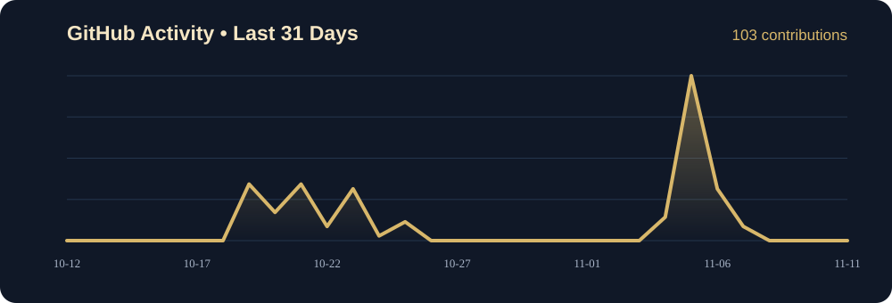
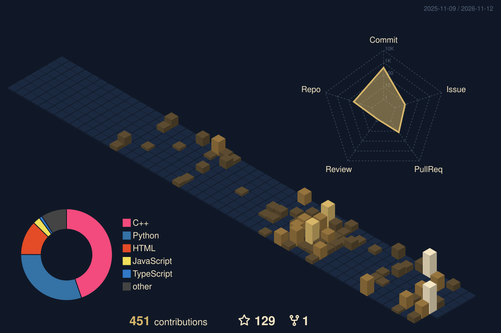
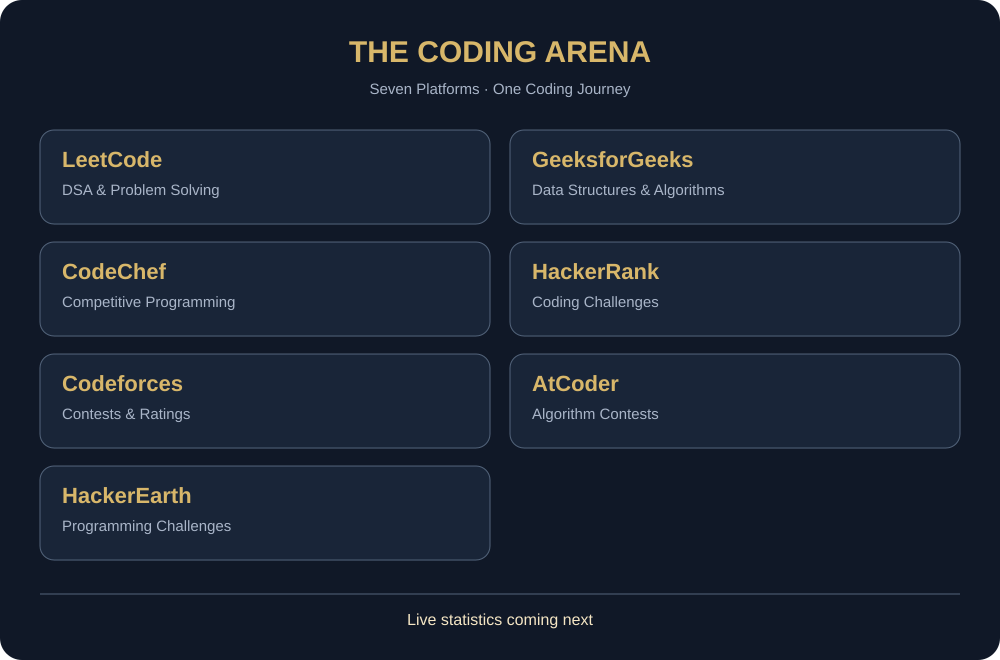

### ✨ Welcome to My Developer Universe

Building projects, exploring technologies, and sharing my coding journey.

---

## 💻 Tech Stack & Tools

### Programming Languages

### Frontend Development

### Development Tools

&nbsp;

---

<!-- BEGIN PAC-MAN ANIMATION -->

## 🟡 My Contribution Arcade

*Every contribution is another step in my coding journey!*

<picture>
  <source
    media="(prefers-color-scheme: dark)"
    srcset="https://raw.githubusercontent.com/SanjanaGadamsetty/SanjanaGadamsetty/output/pacman-contribution-graph-dark.svg"
  />
  <source
    media="(prefers-color-scheme: light)"
    srcset="https://raw.githubusercontent.com/SanjanaGadamsetty/SanjanaGadamsetty/output/pacman-contribution-graph.svg"
  />
  
</picture>

<!-- END PAC-MAN ANIMATION -->

---

<!-- BEGIN ACTIVITY-GRAPH -->

## 📈 My GitHub Activity Graph

*Every contribution tells a story of growth.*

<!-- END ACTIVITY-GRAPH -->

---

<!-- BEGIN 3D CONTRIBUTION SKYLINE -->

## 🌃 My 3D Contribution Skyline

*Building my developer journey, one contribution at a time.*

<!-- END 3D CONTRIBUTION SKYLINE -->

---

<!-- BEGIN CODING ARENA -->

## 🏆 The Coding Arena

### Seven Platforms. One Coding Journey.

*Every problem solved is another step forward.*

### 🌐 Explore My Coding Profiles

| Platform | Focus | My Profile |
|:---|:---|:---:|
| 🟡 **LeetCode** | DSA & Problem Solving | [View Profile](https://leetcode.com/u/sanjana-gadamsetty/) |
| 🟢 **GeeksforGeeks** | Data Structures & Algorithms | [View Profile](https://www.geeksforgeeks.org/profile/gvnsanjana09) |
| 🟤 **CodeChef** | Competitive Programming | [View Profile](https://www.codechef.com/users/bit_flux_radha) |
| 💚 **HackerRank** | Coding Challenges | [View Profile](https://www.hackerrank.com/profile/gvnsanjana_ds) |
| 🔵 **Codeforces** | Contests & Ratings | [View Profile](https://codeforces.com/profile/gvnsanjana) |
| ⚪ **AtCoder** | Algorithmic Contests | [View Profile](https://atcoder.jp/users/sanjanagvn) |
| 🟣 **HackerEarth** | Programming Challenges | [View Profile](https://www.hackerearth.com/@gvnsanjana.ds) |

### 📊 Live Coding Statistics

*Tracking progress across my coding journey.*

<!-- BEGIN LIVE CODING STATS -->

<!-- Verified coding statistics will be added here -->

<!-- END LIVE CODING STATS -->

<!-- END CODING ARENA -->

---

## 🌌 Explore My Developer Universe

🎮 **Developer RPG** · 🪐 **Project Galaxy**

🌤️ **Coding Weather** · 🔮 **Daily Coding Fortune**

*More features coming soon.*

---

## 🔗 Connect With Me

[GitHub](https://github.com/SanjanaGadamsetty)
&nbsp; • &nbsp;
[Portfolio](https://portfolio.gvnsanjana.in)

---

*Thanks for visiting my developer universe!*

