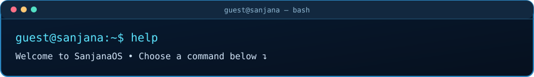
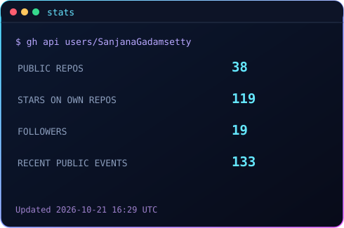
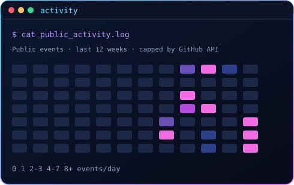
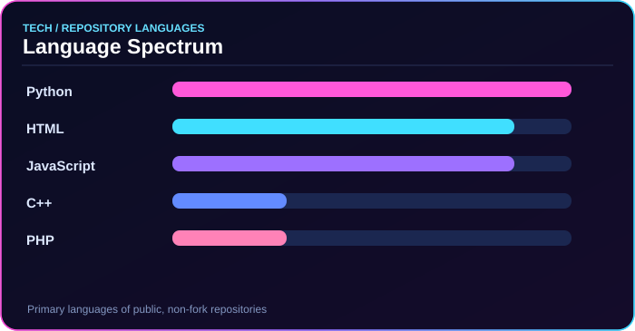
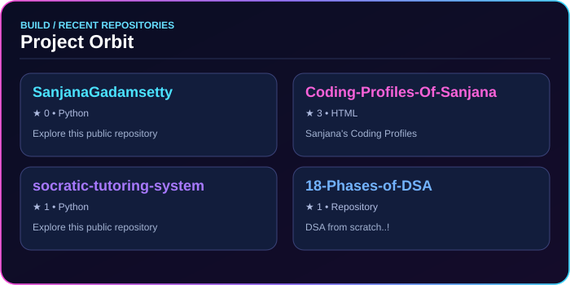
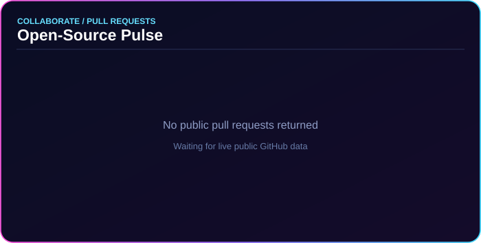

<div align="center">

<!-- PROFILE TERMINAL · Designed for GitHub's native Markdown renderer -->


**`●`** `sanjana@github:~$` **`whoami`**

*AI & Data Science student · Full-stack builder · DSA enthusiast · Open-source contributor*

[](https://github.com/SanjanaGadamsetty)
[](https://www.linkedin.com/in/sanjanagadamsetty/)
[](https://sanjanagadamsetty.github.io/Coding-Profiles-Of-Sanjana/)

</div>

---

<!-- SANJANA OS: GITHUB-NATIVE EXPANDABLE TERMINAL -->
<div align="center">

### `sanjana@github:~$ ./launch-sanjana-os`

<details>
<summary><b>💠 ⌘ LAUNCH SANJANA OS TERMINAL — CLICK TO OPEN</b></summary>

<br>



</div>

<pre>
guest@sanjana:~$ help

IDENTITY      whoami  about  education  journey  neofetch
ENGINEERING   skills  stack  projects  experience
CODING        coding  github  opensource  achievements
PERSONAL      art  now  goals  contact
SYSTEM        history  date  clear  theme
EASTER EGGS   sudo hire-me  coffee  fortune  matrix

</pre>

<p><b>guest@sanjana:~$</b> select a command below ↴</p>


<p><b>▸ IDENTITY</b></p>

<details>
<summary><code>guest@sanjana:~$ whoami</code></summary>

<pre>NAME       Sanjana Gadamsetty
ROLE       AI &amp; Data Science student
IDENTITY   Full-stack developer / AI explorer
LOCATION   Chennai, India
MOTTO      Turn ideas into reality.</pre>

</details>

<details>
<summary><code>guest@sanjana:~$ about</code></summary>

<pre>I build full-stack applications, explore AI/ML,
solve coding challenges, and contribute to open source.
Beyond code: calligraphy, painting, poetry and stories.</pre>

</details>

<details>
<summary><code>guest@sanjana:~$ education</code></summary>

<pre>[01] St. Joseph&#x27;s College of Engineering
     B.Tech — Artificial Intelligence &amp; Data Science
[02] IIT Madras
     BS — Data Science (online)</pre>

</details>

<details>
<summary><code>guest@sanjana:~$ journey</code></summary>

<pre>2025  Exploring engineering and software
2026  Full-stack projects, internship, open source
NEXT  Product-based internship and deeper engineering</pre>

</details>

<details>
<summary><code>guest@sanjana:~$ neofetch</code></summary>

<pre>       .------.        sanjana@github
      / .----. \       --------------
     | |  &lt;&gt;  | |      OS       SanjanaOS 1.0
     | |______| |      Role     AI &amp; DS / Full-stack
      \________/       Focus    AI • DSA • Open Source
        /____\         Theme    Midnight Blue / Cyan</pre>

</details>

<p><b>▸ ENGINEERING</b></p>

<details>
<summary><code>guest@sanjana:~$ skills</code></summary>

<pre>LANGUAGES   Python, C, C++, Java, JavaScript, SQL
FRONTEND    React, HTML, CSS, Tailwind
BACKEND     FastAPI, Node.js, Express, PHP, Django
DATABASES   PostgreSQL, MySQL, MongoDB
AI / DATA   Pandas, scikit-learn
TOOLS       Git, AWS, Linux, VS Code</pre>

</details>

<details>
<summary><code>guest@sanjana:~$ stack</code></summary>

<pre>Frontend  → React / TypeScript / Tailwind
Backend   → FastAPI / Node.js / Express
Database  → PostgreSQL / MySQL
AI / ML   → Python / scikit-learn
Cloud     → AWS fundamentals</pre>

</details>

<details>
<summary><code>guest@sanjana:~$ projects</code></summary>

<pre>01  Aisle Manager — smart store navigation
02  Placement Readiness — AI mock interviews
03  Deadline Goblin — deadline tracking
04  Byte Learning — interactive learning capsules</pre>

</details>

<details>
<summary><code>guest@sanjana:~$ experience</code></summary>

<pre>TNEB / TNPDCL internship (2026)
• PHP/MySQL web applications and admin panels
• Feedback and candidate management portals
• Security, reporting and data analysis
• Employee attrition prediction ML assignment</pre>

</details>

<p><b>▸ CODING</b></p>

<details>
<summary><code>guest@sanjana:~$ coding</code></summary>

<pre>LeetCode     gvnsanjana
CodeChef     bit_flux_radha
Codeforces   gvnsanjana
HackerRank   gvnsanjana_ds
AtCoder      sanjanagvn
CSES         402663</pre>

</details>

<details>
<summary><code>guest@sanjana:~$ github</code></summary>

<pre>USERNAME     SanjanaGadamsetty
PROFILE      github.com/SanjanaGadamsetty

See the live generated GitHub stats below.</pre>

</details>

<details>
<summary><code>guest@sanjana:~$ opensource</code></summary>

<pre>Contributions and investigations:
• hiero-bot-py
• Truxify
• WinAurex
• DesktopAI

Check the dynamic open-source panel below for updates.</pre>

</details>

<details>
<summary><code>guest@sanjana:~$ achievements</code></summary>

<pre>🏆 Best Paper Presentation Award
💻 SkillRack: 1300+ problems (reported milestone)
🧩 LeetCode: 100+ problems (reported milestone)
🌱 Open-source contributor</pre>

</details>

<p><b>▸ PERSONAL</b></p>

<details>
<summary><code>guest@sanjana:~$ art</code></summary>

<pre>BEYOND THE CODE
Brush lettering • Calligraphy
Madhubani • Pattachitra • Warli
Pencil portraits • Acrylic • Watercolor
Poetry • Stories • Creative experiments</pre>

</details>

<details>
<summary><code>guest@sanjana:~$ now</code></summary>

<pre>[&gt;] Building full-stack applications
[&gt;] Practicing DSA and problem solving
[&gt;] Exploring AI agents and cloud systems
[&gt;] Contributing to open source</pre>

</details>

<details>
<summary><code>guest@sanjana:~$ goals</code></summary>

<pre>[ ] Product-based internship
[ ] Stronger DSA and system design
[ ] Ship polished, useful applications
[ ] Grow as an open-source contributor</pre>

</details>

<details>
<summary><code>guest@sanjana:~$ contact</code></summary>

<pre>GitHub:   github.com/SanjanaGadamsetty
LinkedIn: linkedin.com/in/sanjanagadamsetty
Profiles: sanjanagadamsetty.github.io/Coding-Profiles-Of-Sanjana/</pre>

</details>

<p><b>▸ SYSTEM</b></p>

<details>
<summary><code>guest@sanjana:~$ history</code></summary>

<pre>This is a README, not a live shell.
Click command rows to explore responses.</pre>

</details>

<details>
<summary><code>guest@sanjana:~$ date</code></summary>

<pre>Dynamic local time requires JavaScript.
This README-only terminal does not run code.</pre>

</details>

<details>
<summary><code>guest@sanjana:~$ clear</code></summary>

<pre>To collapse the terminal, click the top heading again.</pre>

</details>

<details>
<summary><code>guest@sanjana:~$ theme</code></summary>

<pre>ACTIVE THEME: Midnight Blue / Electric Cyan
GitHub controls the final README background.</pre>

</details>

<p><b>▸ EASTER EGGS</b></p>

<details>
<summary><code>guest@sanjana:~$ sudo hire-me</code></summary>

<pre>[sudo] checking compatibility...
✓ Curiosity detected
✓ Problem-solving enabled
✓ Creativity online
ACCESS GRANTED — try contact!</pre>

</details>

<details>
<summary><code>guest@sanjana:~$ coffee</code></summary>

<pre>       ( (
        ) )
      ........
      |      |]
      \      /
       `----&#x27;
ERROR 418: I&#x27;m a teapot. ☕</pre>

</details>

<details>
<summary><code>guest@sanjana:~$ fortune</code></summary>

<pre>&quot;Somewhere between a bug and a breakthrough,
a developer learns something extraordinary.&quot;</pre>

</details>

<details>
<summary><code>guest@sanjana:~$ matrix</code></summary>

<pre>01010011 01000001 01001110
01001010 01000001 01001110 01000001
Wake up, developer. There&#x27;s code to write.</pre>

</details>

<details>
<summary><code>guest@sanjana:~$ help</code></summary>

<pre>IDENTITY      whoami  about  education  journey  neofetch
ENGINEERING   skills  stack  projects  experience
CODING        coding  github  opensource  achievements
PERSONAL      art  now  goals  contact
SYSTEM        history  date  clear  theme
EASTER EGGS   sudo hire-me  coffee  fortune  matrix</pre>

</details>

<p><code>guest@sanjana:~$ exit</code> — click the launch heading to close.</p>

</details>

<!-- END SANJANA OS -->

---

### `sanjana@github:~$ cat about_me.txt`

```yaml
name: Sanjana Gadamsetty
education:
  - B.Tech Artificial Intelligence & Data Science
  - IIT Madras BS in Data Science
focus:
  - Full-Stack Development
  - AI / Machine Learning
  - Data Structures & Algorithms
  - Open Source
motto: "Turn ideas into reality."
```

### `sanjana@github:~$ gh api /users/SanjanaGadamsetty`

<div align="center">
<table><tr><td></td><td></td></tr></table>
</div>

> These are **public GitHub API metrics**. The activity grid represents recent **public events**, not GitHub's official contributions calendar.

### `sanjana@github:~$ ls ~/tech-stack`

<div align="center">

</div>

**Languages** · `Python` `C` `C++` `Java` `JavaScript` `SQL`  
**Frontend** · `React` `HTML` `CSS` `Tailwind` `Bootstrap`  
**Backend** · `FastAPI` `Node.js` `Express` `PHP` `Django`  
**Databases** · `PostgreSQL` `MySQL` `MongoDB`  
**AI & Tools** · `scikit-learn` `Pandas` `Git` `AWS` `Linux`

### `sanjana@github:~$ ls ~/featured-projects`

| Project | What it does | Stack |
| :--- | :--- | :--- |
| **Aisle Manager** | Store navigation, shopping routes and product mapping | React · FastAPI · PostgreSQL |
| **Placement Communication Readiness** | AI-assisted mock interview and speaking practice platform | React · Node.js · FastAPI |
| **Deadline Goblin** | Deadline and registration tracking web app | React · Backend APIs |
| **Byte Learning** | Bite-sized interactive coding learning capsules | HTML · CSS · JavaScript |

<div align="center">

</div>

### `sanjana@github:~$ gh search prs --author @me`

<div align="center">

</div>

[**Explore all my public pull requests →**](https://github.com/pulls?q=is%3Apr+author%3ASanjanaGadamsetty)

### `sanjana@github:~$ ./coding_profiles.sh`

| Platform | Profile |
| :--- | :--- |
| LeetCode | [Visit →](https://leetcode.com/u/gvnsanjana/) |
| CodeChef | [Visit →](https://www.codechef.com/users/bit_flux_radha) |
| Codeforces | [Visit →](https://codeforces.com/profile/gvnsanjana) |
| HackerRank | [Visit →](https://www.hackerrank.com/profile/gvnsanjana_ds) |
| GeeksforGeeks | [Visit →](https://www.geeksforgeeks.org/profile/gvnsanjana09) |
| AtCoder | [Visit →](https://atcoder.jp/users/sanjanagvn) |
| CSES | [Visit →](https://cses.fi/user/402663) |
| All profiles | [Open my directory →](https://sanjanagadamsetty.github.io/Coding-Profiles-Of-Sanjana/) |

### `sanjana@github:~$ ./contribution-snake.sh`

<div align="center">

</div>

### `sanjana@github:~$ cat currently_building.md`

```text
[>] Building full-stack and AI projects
[>] Practicing algorithms and problem solving
[>] Contributing to open-source projects
[>] Exploring cloud engineering and agentic AI
```

<div align="center">

`> Same girl. Bigger dreams. Brighter code. ✦`

**`sanjana@github:~$`** `exit`

</div>
